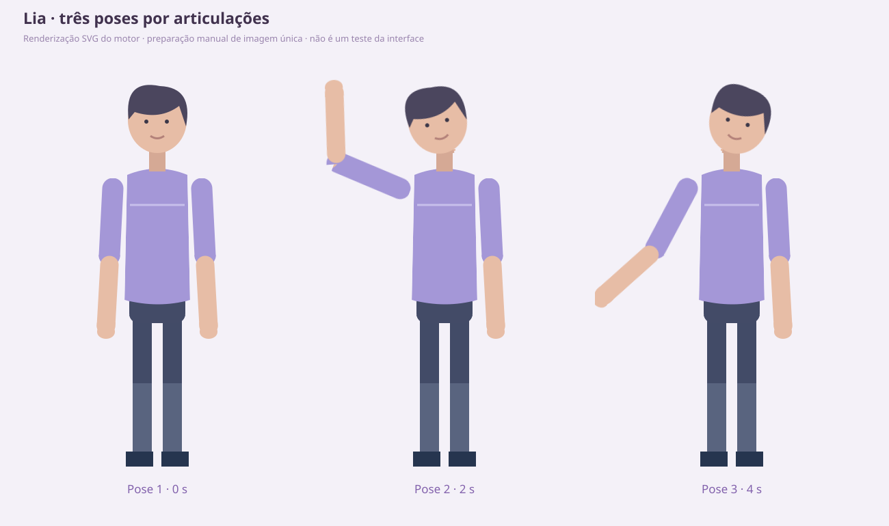

# Articulações 2D no EBOOK AI STUDIO

Incremento do Estúdio de Vídeos existente, 4 de novembro de 2026. Não foi criada outra aplicação nem alterada a autenticação. MP4 continua indisponível.

## Disponibilidade e verificação

| Área | Estado | Verificação realizada |
| --- | --- | --- |
| Hierarquia, rotação e limites | Implementado | Testes matemáticos de FK, propagação para descendentes, limites e rejeição de ciclos |
| IK de dois segmentos | Implementado | Testes de alcance e limites de rotação |
| Pontos-chave, interpolação, suavidade e velocidade | Implementado | Três poses; interpolação linear/suave; velocidade; preservação após corte e trim |
| Guardar/reabrir projetos articulados | Implementado | API com identidade e D1 simulados: partes, articulações e todos os pontos-chave preservados |
| Biblioteca de personagens preparados | Implementado | Gravar, listar, reutilizar snapshots; isolamento por conta e validação de recursos; proteção de imagens em uso |
| Criação/arrasto de articulações e partes | Interface implementada | Compilação e TypeScript; gestos reais no navegador ainda não verificados |
| Recorte retangular/poligonal e associação de imagens separadas | Implementado | Testes do formato, geometria e referências; renderização SVG de partes; interação manual no navegador pendente |
| Desfazer/refazer do documento | Integrado no histórico existente | Integridade dos snapshots testada; atalhos e gestos no navegador pendentes |
| Pré-visualização SVG das partes | Implementado | Componente real renderizado em três poses e inspecionado visualmente fora do navegador |
| Deteção automática MediaPipe | Experimental, implementada | Compilação do Web Worker e testes do mapeamento/rejeição de landmarks; inferência real, rede/modelo e precisão em personagens ainda não verificadas |
| Malha deformável / separação automática | Pendente | Investigação de viabilidade documentada; não apresentada como funcional |
| Reconstrução de regiões escondidas | Pendente, experimental | Não obrigatória para o modo manual; nenhuma reconstrução simulada |
| MP4 | Pendente | Exportação não ativada nem declarada concluída |
| i7 11.ª geração, 16 GB sem GPU dedicada | Não verificado | Não foi executado benchmark nesse hardware |

A pré-visualização gerida retornou `preview relay unavailable`. O navegador de teste não dispõe de uma sessão autenticada da aplicação privada. As verificações técnicas e a renderização do componente SVG não substituem testes de interação no navegador.

## Teste obrigatório: três poses

1. Abrir **Estúdio de Vídeos → Projetos → Teste articulado · 3 poses**.
2. O projeto novo usa o cenário, gameplay, texto e áudio do teste narrativo existente. Não substitui projetos guardados.
3. Selecionar **Lia · 3 poses articuladas** na linha do tempo.
4. Premir **Editar articulações** e mudar para **Animação**.
5. Reproduzir. A sequência tem pontos-chave locais aos 0, 2 e 4 segundos (no projeto: 1, 3 e 5 s). O ombro levanta o braço, o cotovelo dobra e a cabeça muda de orientação.
6. Selecionar uma articulação para alterar a rotação, limites e suavidade; arrastar uma parte para rodar a articulação. Arrastar pulso/tornozelo com IK ativo move os dois segmentos ascendentes.
7. Criar uma pose completa na posição da agulha ou adicionar um ponto apenas à articulação selecionada.
8. Guardar o projeto e fechar o editor. Recarregar a aplicação, voltar a **Estúdio de Vídeos → Projetos** e abrir o projeto guardado.
9. Confirmar as 16 articulações, 16 partes e os três pontos-chave nos ombro/cotovelo/cabeça. Confirmar também os marcadores nas linhas individuais das articulações, abaixo das faixas normais.

A imagem é uma renderização do motor, não uma captura de um teste da interface. A personagem é um recurso de demonstração preparado manualmente, sem deteção automática.

## Preparação manual de uma imagem única

A imagem PNG de Lia é uma imagem única, não um conjunto de ficheiros separados. O exemplo guarda 16 recortes dessa mesma imagem e um polígono no tronco. Ombro, cotovelo e cabeça têm as suas próprias curvas. As transparências, recortes e articulações são preservados no documento do projeto.

Para preparar outra imagem:

1. Importar um PNG/WebP estático com fundo transparente e adicioná-lo à linha do tempo.
2. Selecionar o elemento e abrir **Editar articulações**.
3. Usar **Iniciar manual vazio**, ou **Modelo humano manual**. O modelo humano é geométrico e não é uma identificação da imagem.
4. Em **Preparação**, criar articulações clicando na imagem e ajustar a hierarquia pelo campo **Ascendente**. O modelo inicial inclui cabeça, pescoço, tronco, quadril, ombros, cotovelos, pulsos, quadris laterais, joelhos e tornozelos.
5. Arrastar as articulações para os pivôs corretos. Configurar limites de rotação.
6. Selecionar uma articulação e escolher **Retângulo** ou **Polígono**. Isolar a região da imagem que deve seguir essa articulação; concluir o polígono quando tiver pelo menos três pontos.
7. Ajustar colocação, largura, altura, rotação e ordem das partes. Uma parte pode ser associada a outra articulação no painel direito.
8. Repetir para os membros necessários. Desativar **Imagem de referência** para inspecionar apenas as partes.
9. Mudar para **Animação** e criar os pontos-chave. Sem recortes, só o esqueleto se move; a imagem continua estática, como é indicado na interface.

Preparações manuais necessárias: contornar membros sem incluir outros, escolher pivôs nas uniões, ordenar as partes, preparar pequenas sobreposições nas juntas e pintar/importar material extra para zonas inicialmente escondidas. Um recorte não inventa os pixels que não existem. As partes são rígidas; não existe skinning de malha nesta versão.

## Partes em ficheiros separados

Importar cabeça, tronco, braços e pernas como imagens da biblioteca. No editor de articulações, escolher Retângulo/Polígono e selecionar essa imagem no campo **Imagem para recortar**. **Usar a imagem completa como parte** associa o ficheiro à articulação escolhida. Ajustar colocação e tamanho nos campos ou por arrasto em Preparação. Não é necessário enviar os ficheiros a uma API de IA.

## Animação e linha do tempo

- A preparação guarda as posições de referência. A rotação de base aparece na pré-visualização de Animação; a vista de Preparação mostra a posição de ligação sem as rotações animadas.
- Editar rotação em Animação ou arrastar uma parte cria/altera o ponto-chave no instante atual. O primeiro ponto num instante posterior a zero preserva a rotação inicial em zero.
- A interpolação segue os ângulos numéricos locais entre pontos. As opções são linear, suave (smoothstep), acelerar e desacelerar, por intervalo.
- A velocidade do personagem altera apenas o relógio das articulações; os movimentos globais do elemento, gameplay e áudio mantêm os seus próprios tempos.
- O IK usa CCD nos dois ascendentes do ponto arrastado, com limites por articulação. Não é IK de corpo inteiro nem mantém automaticamente os pés fixos no chão.
- A raiz pode ser posicionada em Preparação. Para translação animada do personagem, continuam disponíveis os pontos-chave globais de X/Y do elemento de vídeo.
- As linhas individuais das articulações mostram os pontos-chave abaixo das faixas normais quando o personagem está selecionado. Clicar num ponto abre a articulação nesse instante. O tempo pode ser editado no respetivo campo dentro do editor.
- Os cortes conservam a curva completa e deslocam o relógio do rig, sem alterar a interpolação suave. Estender o elemento pode voltar a expor pontos antes ocultos pelo corte.
- Poses por troca da imagem original são preservadas. Quando o rig está ativo e tem partes, estas têm prioridade visual. Desativar o rig volta à reprodução das poses de imagem existente.
- Limites do protótipo: 32 articulações, 40 partes, 80 pontos por articulação; velocidade entre 0,1× e 4×. Mantém-se o limite de tamanho do JSON do projeto e os restantes limites do Estúdio de Vídeos.

## Biblioteca e persistência

**Guardar personagem na biblioteca** grava um snapshot do rig e das curvas, associado à conta. O separador **Preparados** permite adicioná-lo a outro vídeo sem repetir a preparação. Cada vídeo recebe uma cópia independente; alterações posteriores não modificam outros projetos.

Os dados do rig são opcionais no elemento de imagem. Os documentos antigos, sem rig, continuam válidos. Os recursos só podem referenciar imagens da conta ou os exemplos autorizados. As imagens em uso em projetos ou personagens preparados estão protegidas contra eliminação. Eliminar uma preparação não elimina imagens nem rigs incorporados em projetos.

Nova migração aditiva: `0002_elite_bloodstorm.sql`, apenas para `prepared_characters`. As tabelas anteriores e as migrações aplicadas não foram alteradas. Um teste SQLite preservou os registos de um eBook e de um projeto de vídeo existentes.

A gravação continua explícita: **Guardar projeto** ou Ctrl/Cmd+S. O histórico de desfazer/refazer pertence à sessão; não é uma história de versões persistente. Guardar um personagem na biblioteca e guardar o projeto são operações distintas, com mensagens de resultado separadas.

## Fase 2 — identificação automática local

O botão **Preparar automaticamente** tenta executar MediaPipe Pose Landmarker Lite no navegador, num Web Worker, com delegate CPU e uma imagem reduzida até 768 px. Não necessita de chaves comerciais. Apenas o modelo e o runtime WASM são descarregados de endereços públicos; a imagem é lida do próprio Site e enviada ao worker local, não a um serviço de análise.

O SDK está fixado em `@mediapipe/tasks-vision@1.2.2`. A primeira utilização requer rede para obter o runtime no CDN jsDelivr e o modelo no alojamento oficial Google. Falhas de rede, CSP, codec, worker ou confiança são apresentadas como falhas. O esqueleto manual existente não é substituído; uma proposta só é aplicada após revisão e ação explícita do utilizador. Não existe fallback geométrico disfarçado de deteção.

A proposta apenas posiciona articulações. Exige recorte e ligação manual das partes. Modelos de pose humana podem falhar em ilustrações, anatomias estilizadas, personagens parciais ou membros ocultos. A inferência real ainda não foi verificada neste ambiente; a funcionalidade está marcada como experimental.

Referências oficiais consultadas:
- https://developers.google.com/edge/mediapipe/solutions/vision/pose_landmarker
- https://developers.google.com/edge/mediapipe/solutions/vision/pose_landmarker/web_js
- https://github.com/google-ai-edge/mediapipe/blob/master/mediapipe/tasks/web/vision/README.md
- https://github.com/google-ai-edge/mediapipe/blob/master/LICENSE

MediaPipe é distribuído sob Apache-2.0. O modelo e o runtime são dependências externas, não um serviço de geração de vídeo.

## Fase 3 — separação e reconstrução

- **SAM 2:** candidato de código aberto para segmentação orientada por cliques/máscaras. O projeto oficial usa Python/PyTorch e descreve instalação orientada a GPU/CUDA. Não foi integrado nem testado no hardware pretendido; segmentar pixels não reconstrói automaticamente regiões escondidas nem fornece uma preparação artística pronta para rig.
  - https://github.com/facebookresearch/sam2
- **Inpainting:** ferramentas como IOPaint mostram possibilidades de preenchimento com modelos locais, mas têm dependências próprias e resultados que precisam de revisão. O repositório consultado está arquivado desde agosto de 2025; não se assume manutenção ou compatibilidade.
  - https://github.com/Sanster/IOPaint
- **Malhas deformáveis:** poderá ser acrescentado um editor de malha/triangulação com pesos por osso, mas ainda não há atribuição de pesos, skinning ou correção de deformações nesta versão.

Alternativa funcional nesta fase: recortes manuais, partes independentes, ordem das partes e importação de imagens retocadas. Sem comprometer o editor manual caso a automação exija recursos incompatíveis.

## Comandos e limites dos testes

- `node scripts/test-rig.mjs`: inclui os testes de vídeo anteriores e os novos testes matemáticos, de schema, API e persistência com D1/R2/identidade simulados.
- `node scripts/test-studio.mjs`: regressão da API inicial de eBooks/projetos.
- `npx tsc --noEmit`: tipos.
- Build pelo helper do Site: compilação da aplicação e do worker de deteção.
- `node scripts/render-rig-proof.mjs`: renderiza o componente React/SVG real em 0, 2 e 4 s e verifica imagens não vazias; usa Sharp disponível no ambiente de desenvolvimento. Não é exportação MP4 nem teste de interação.

Não se declara testado: clique/arrasto real, atalhos no navegador, gravação/reabertura numa sessão de produção, inferência MediaPipe real ou desempenho no i7/16 GB. A composição SVG e os testes numéricos são evidência do motor, não garantia de compatibilidade num computador específico.
